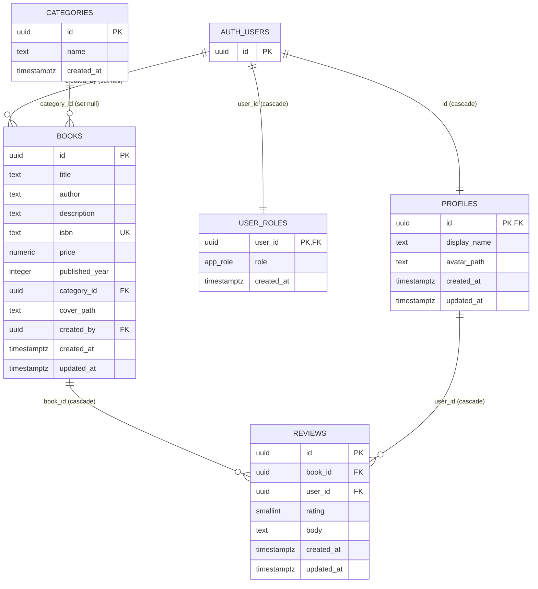

# Database

Everything here is taken from the SQL files in `supabase/migrations/`. The database is Supabase PostgreSQL. Row Level Security (RLS) is enabled on all five tables and is the authorization boundary of the app (see [architecture.md](architecture.md)).

## Entity relationship diagram

`auth.users` is owned by Supabase Auth and is shown only as the target of the foreign keys.

The enum `app_role` has two values: `user` and `admin`.

## Tables

### profiles
Public-facing user data. There is no email column: emails exist only in `auth.users`.

- `id` is the primary key and references `auth.users(id)` with `on delete cascade`.
- `display_name` is required, must contain a visible character and is at most 100 characters.
- `avatar_path` is the path of the file in the `avatars` bucket, or null.

### user_roles
One row per user: `user_id` (primary key, references `auth.users(id)`, cascade) and `role` (`app_role`, default `user`).

### categories
`id`, `name`, `created_at`. The name must contain a visible character. A unique index on `lower(name)` makes names unique ignoring case.

### books
- `title` and `author` are required and must contain a visible character.
- `isbn` is optional and unique (if present it must contain a visible character).
- `price` is `numeric(10, 2)`, optional, not negative.
- `published_year` is optional, between 1000 and 2100.
- `category_id` references `categories(id)` with `on delete set null`, so deleting a category keeps its books.
- `cover_path` is the path of the file in the `book-covers` bucket, or null.
- `created_by` references `auth.users(id)` with `on delete set null`.

### reviews
- `book_id` references `books(id)` with `on delete cascade` (deleting a book deletes its reviews).
- `user_id` references `profiles(id)` with `on delete cascade`.
- `rating` is `smallint`, 1 to 5.
- `body` is required, must contain a visible character, at most 2000 characters.
- A unique constraint on `(book_id, user_id)` allows one review per user per book.

### Indexes
Besides the primary keys and unique constraints: `categories_name_lower_key` (unique, `lower(name)`), `books_category_id_idx`, `books_created_at_idx`, `reviews_user_id_idx`.

### Deleting an auth user
Because of the foreign keys above, deleting a row from `auth.users` removes that user's profile, role and reviews, and keeps their books with `created_by` set to null. Files in the `avatars` bucket are not removed by this. The app has no feature for deleting users.

## RLS policy intent

`anon` is a visitor, `authenticated` is any signed-in user, "admin" means `is_admin()` returns true.

| Table | Select | Insert | Update | Delete |
|---|---|---|---|---|
| `categories` | everyone | admin | admin | admin |
| `books` | everyone | admin | admin | admin |
| `reviews` | everyone | signed in, only with `user_id` = own id | author or admin | author or admin |
| `profiles` | everyone | nobody (rows are created by the `handle_new_user` trigger) | the owner or admin | admin |
| `user_roles` | the user's own row, or all rows for an admin | admin | admin | admin |

Policy names are in `20261107185726_initial_schema.sql` (for example `reviews_insert_own`, `profiles_update_own_or_admin`, `user_roles_select_own_or_admin`). Policies call `(select public.is_admin())` and `(select auth.uid())`.

## Storage buckets and policies

Defined in `20261107185744_storage_buckets.sql`. Both buckets are public: a file is reachable by its public URL without any `select` policy. The policies on `storage.objects` therefore control listing and API access.

| Bucket | Size limit | Allowed MIME types | Policies |
|---|---|---|---|
| `book-covers` | 2 MB (2,097,152 bytes) | `image/jpeg`, `image/png`, `image/webp` | select, insert, update and delete: admin only |
| `avatars` | 1 MB (1,048,576 bytes) | `image/jpeg`, `image/png`, `image/webp` | select, insert, update and delete: signed-in users, only for objects whose first folder is their own `auth.uid()` (`<user-id>/<file>`) |

## Functions and triggers

| Name | Kind | What it does |
|---|---|---|
| `is_admin()` | function, `SECURITY DEFINER`, stable | Returns true when the caller has the `admin` role in `user_roles`. It is `SECURITY DEFINER` so the policies on `user_roles` can call it without recursing into RLS. Execute is granted to `authenticated` only |
| `handle_new_user()` | trigger function, `SECURITY DEFINER` | Runs after each insert into `auth.users` (trigger `on_auth_user_created`). Creates the profile and a `user` role. The display name comes from the `display_name` signup metadata (trimmed, at most 100 characters) or falls back to `Reader-<first 6 id characters>`; the email is never used. The role is never read from metadata |
| `set_updated_at()` | trigger function | Sets `updated_at = now()` before each update on `profiles`, `books` and `reviews` (trigger `set_updated_at` on each) |
| `freeze_review_keys()` | trigger function | Before an update on `reviews` (trigger `freeze_review_keys`), raises an error if `book_id` or `user_id` changed, for everyone including admins |
| `admin_list_users(p_search, p_limit, p_offset)` | function, `SECURITY DEFINER`, stable | Admin only (error `42501` otherwise). Returns id, email, display name, role, created date and `total_count`; limit clamped to 1–50; search characters `%`, `_`, `\` are literal |
| `admin_set_user_role(p_user_id, p_role)` | function, `SECURITY DEFINER` | Admin only. Raises `22023` when the target is the caller or an argument is null, `P0002` when the user does not exist; otherwise inserts or updates the role |

Privileges: `handle_new_user`, `set_updated_at` and `freeze_review_keys` have execute revoked from `public`, `anon` and `authenticated` (triggers do not need it). `is_admin`, `admin_list_users` and `admin_set_user_role` are revoked from `public` and `anon` and granted to `authenticated`. All functions set `search_path = ''`.

## Migration history

In `supabase/migrations/`, applied in this order:

| File | Purpose |
|---|---|
| `20261107185726_initial_schema.sql` | `app_role` enum; tables `profiles`, `user_roles`, `categories`, `books`, `reviews`; indexes; functions and triggers; backfill of profiles and roles for users that already existed; all RLS policies |
| `20261107185744_storage_buckets.sql` | The `book-covers` and `avatars` buckets and their `storage.objects` policies |
| `20261107190515_revoke_rls_auto_enable_api_access.sql` | Revokes execute on `public.rls_auto_enable()` from `public`, `anon` and `authenticated`, only if that function exists (checked with `to_regprocedure`), so the step is skipped on a project without it. According to the migration's comment this is an event-trigger function (`ensure_rls`) that exists in the hosted project and is not created by these migration files |
| `20261108124819_admin_user_functions.sql` | `admin_list_users` and `admin_set_user_role` with their privileges |

The project rule is that every schema change is saved as a SQL migration in this folder.
